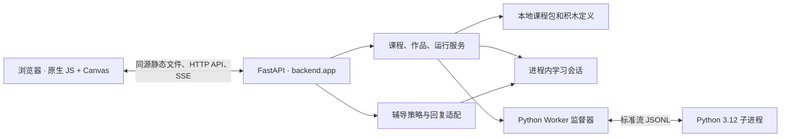

# Windows Demo 实现架构

本页描述当前代码的入口、模块职责和关键状态。产品范围见 [项目计划](../项目计划.md)，历史设计和验收入口见 [README](../README.md#文档导航)。

## 运行拓扑

默认启动命令将服务绑定到回环地址 `127.0.0.1:8000`。浏览器从同一服务获取静态资源，并通过 `/api/v1` 提交结构化积木程序。主进程负责课程门禁、运行会话和 SSE。Worker 负责生成 Python、应用 AST 白名单、受限执行并回传事件。

## 代码地图

| 模块 | 职责 |
|---|---|
| [frontend/js/main.js](../frontend/js/main.js) 与 [state.js](../frontend/js/state.js) | 装配视图并绑定页面入口，维护当前任务、程序状态、编辑修订号与课程版本 |
| [frontend/js/workflows/](../frontend/js/workflows/) | 作品保存与打开、课程刷新、预测提交。工作区替换共用 `prepareWorkspaceChange()` |
| [frontend/js/views/](../frontend/js/views/) | 展示课程、工具箱、画布、结果与辅导，`artifact.js` 统一应用作品和任务的编辑区状态，`runner.js` 管理运行、停止、SSE 与断线恢复 |
| [frontend/js/editor/](../frontend/js/editor/) 与 [core/](../frontend/js/core/) | 编辑器负责程序树、连接、几何、拖放和撤销，`core/` 提供运行门禁、会话和异步响应归属规则 |
| [frontend/js/ux/](../frontend/js/ux/) | `workbenchPanels.js` 连接面板、断点和焦点；同目录模块从现有状态派生主操作、运行结果、舞台和总结 |
| [backend/app.py](../backend/app.py) 与 [api/](../backend/api/) | 应用工厂、静态文件托管、路由、入参模型与错误包封 |
| [backend/service/](../backend/service/) | 课程加载与缓存、启动检查、作品保存与迁移入口以及运行编排 |
| [backend/domain/](../backend/domain/) 与 [runner/](../backend/runner/) | 领域层维护积木定义、程序校验和迁移，运行层负责代码生成、执行策略、资源限制和进程通信 |
| [backend/tutor/](../backend/tutor/)、[session/](../backend/session/) 与 [infra/](../backend/infra/) | 辅导策略、回复校验和模拟兜底，学习证据与运行尝试的内存存储，环境配置与脱敏日志 |
| [content/demo-loop/](../content/demo-loop/) 与 [schemas/](../schemas/) | 一个循环主题课程及其主任务、变式、辅导回复和版本化数据定义 |
| [harmony/](../harmony/) | 独立的 ArkTS / ArkUI 示例工程，Windows Demo 的启动与执行链路无需鸿蒙工具链 |

## 关键流程

1. **编辑与运行。** 画布可以包含多组积木，每组有自己的坐标和程序树。`workspace.js` 处理拖动、拆组和跨组连接。后端检查任务、预测和程序结构，再按作品中各组的顺序把以「当开始」开头的脚本编译给 Worker。循环体仍按 `body` 和各链的 `next` 顺序处理。运行进入终态后，页面可继续拖放。
2. **停止与断线。** 浏览器使用取消凭据请求停止，并通过 SSE 或运行摘要确认终态。连接断开且确认运行结束后可再次提交。仍无法确认时，用户可以重试停止。旧运行事件由任务、页面版本和请求标识共同约束。
3. **保存与打开。** 保存请求提交独立的程序快照。自由摆放后使用作品格式 v2，以 `stacks` 保存各组坐标和树。单链作品 v1 继续可读写，v0 在打开时迁移至 v1。响应根据页面上下文、保存顺序和编辑修订号更新未保存状态。打开作品时，后端校验课程版本和结构，再由 `artifact.js` 统一替换编辑区。作品通过浏览器下载，学习会话保存在后端进程内。
4. **工作区切换。** 任务切换、打开作品、刷新课程和重置，都先确认当前修改，再确认旧运行结束。等待期间如程序又被编辑或操作失效，保留当前工作区。打开作品时以最近选中的文件为准。 [切换条件](../frontend/js/workflows/workspace-change.js)
5. **教学反馈。** 运行受理固定工作区、程序摘要、预测关联和已展示提示。编排层在发出 SSE 终态前生成教学观察，比较积木结构、完成结果和轨迹，再由辅导规则确定提示。局部回放只消费已与舞台终态核对的动作。 [教学设计](CodeMateKids_AI教学增强开发文档.md)

## 状态归属

| 状态 | 由谁维护 | 读写规则 |
| --- | --- | --- |
| 工作区与程序修订号 | `main.js`、`views/artifact.js` | 用 `pageVersion` 区分任务或作品，用 `programRevision` 识别当前代码与请求快照的差别 |
| 预测 | `workflows/predictions.js` | 每个任务只提交一个进行中的预测。相同课程版本内可记录迟到的成功响应，只有当前工作区显示其表单反馈 |
| 运行状态与取消凭据 | `views/runner.js`、`core/runSession.js` | 凭据留在运行控制器内。停止、断线与切换共享终态确认，同一运行的并发确认复用请求 |
| 前端积木定义与校验 | `state.blocksByKind`、`editor/model.js` | 校验函数显式接收定义，运行门禁和画布以同一份定义判断可运行性 |
| 服务端学习证据 | `backend/session/store.py`、`backend/session/teaching_store.py` | 教学快照按课程版本、任务和工作区归属。学习记录随本地进程清空 |

## 如何扩展

- **新增积木或参数。** 先在[积木清单](../schemas/blocks.v1.json)定义端口、默认值与数值范围。涉及新运行语义时同步[后端校验](../backend/domain/program.py)、[Python 生成](../backend/runner/compiler.py)和[编辑器预览](../frontend/js/views/canvas.js)，补充[能力矩阵](matrix.md)和回归。参数接受数字积木时，前端的连接判断、直接输入和嵌入后编辑遵循同一字段约束。
- **新增循环课任务。** 在[课程包](../content/demo-loop/)中同步任务、起始程序、可用积木和提示。保存和运行从任务的起始程序取课程引用。仅修改课程内容时递增 `contentVersion`，涉及作品格式或协议时核对相应版本和兼容用例。
- **调整课堂布局。** 面板和焦点从 `workbenchPanels.js` 接入。断点须同时核对 `ux/layoutMode.js` 与 CSS。Canvas 绘制和有效落点分别由 `editor/render.js` 与 `editor/targets.js` 负责，避免在页面入口复制这些规则。
- **修改运行或工作区切换。** 先补能复现的顺序测试，覆盖提交晚到、终态未确认和保存后再次编辑。浏览器层复验任务、预测、运行和保存打开。 [测试与验收](run.md#测试与验收)

## 数据与验证

- `appVersion` 是应用标识，`courseRef.version` 用于作品匹配课程，`contentVersion` 用于内容刷新。`schemaVersion`、作品格式版本及运行和辅导协议版本分别约束对应接口。 [运行与接口说明](api-contract.md)
- Windows Demo 采用单人单浏览器的进程内会话，默认使用本地模拟回复。系统级隔离、真实模型和鸿蒙构建的验证范围见 [已知限制](known_limitations.md)。
- Python 回归覆盖路由、程序契约和实际 Worker，Node 回归覆盖编辑器、运行控制与作品和课程流程。操作入口和检查记录见 [运行说明](run.md)、[验收记录](acceptance.md) 和 [浏览器检查表](manual-checklist.md)。
